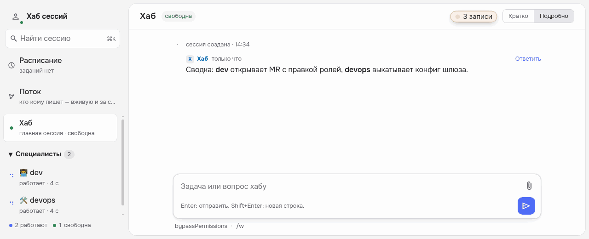

# Лампа записи — плагин Agents Hub

Мигает в поле ввода хаба, когда кто-то из агентов пишет наружу: MR/PR, push, деплой и инфраструктура, запись в базу,
инструменты MCP с записью. Только сигнал: агенты работают дальше, ничего не блокируется.

- **Где.** В поле ввода, слева от скрепки, — во всех лентах с полем; текст поля под лампу не заходит. Где поля нет («Поток», виды плагинов) — в строке заголовка, в пустом промежутке у правого края; не влезает — над нижним краем колонки.
  Висит поверх страницы и ничего не сдвигает. Когда никто не пишет — стоит на месте погашенной: серая, не мигает
  («записей нет», в unix-теме `[ ]`); клик — история за сутки.
- **Как.** Мигает раз в секунду (при «меньше анимации» в системе — горит ровно); запись в базу и удаление — красным (в unix-теме — тем же цветом темы, знак `[‼]`).
  По клику — «Сейчас пишут наружу»: кто, команда, сколько идёт или «ждёт подтверждения»; клик по строке открывает
  сессию. Ниже — свёрнутое «За сутки». Гаснет (снова серая) через 30 с после конца шага.
- **Что ловит.** `git push`; `glab`/`gh` mr/pr create и merge; `kubectl` apply/patch/delete/rollout…; `helm`
  upgrade/install/uninstall; `terraform`/`tofu` apply/destroy; `argocd app` sync/delete; SQL-запись через
  psql/mysql/clickhouse-client и миграции; MCP-инструменты, чьё имя — глагол записи (create, update, delete, merge,
  send, transition…). Команда проверяется по звеньям: `grep "git push"` или `echo` с этими словами — не запись.
- **Темы.** Только токены хаба — годится для любой темы; с [unix-terminal](https://github.com/GreatMedivack/hub-plugin-unix-terminal)
  — терминальный вид `[!] 2 записи` инверсией.

Нужен хаб с API плагинов 1.4. Только страница (`web`), без процесса; читает ленты сессий через `/api/timeline`,
никуда больше не ходит и ничего не пишет.

Код — MIT.
