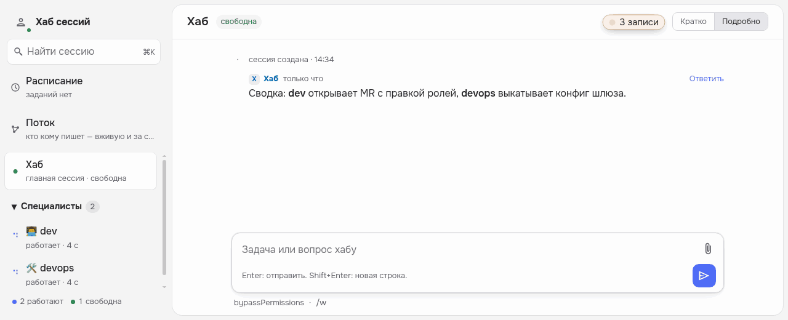

# Write lamp: an Agents Hub plugin

Blinks in the hub's input field when one of the agents writes outside: an MR/PR, a push, a deploy and infrastructure,
a write to a database, MCP tools that write. Only a signal: the agents keep working, nothing is blocked.

- **Where.** In the input field, left of the paperclip, in every feed with a field; the field text does not go under
  the lamp. Where there is no field ("Flow", plugin views), in the title bar, in the empty gap near the right edge; if it
  does not fit, above the bottom edge of the column.
  It floats over the page and shifts nothing. When nobody writes it stays in place, off: gray, not blinking
  ("no writes", `[ ]` in a unix theme); a click shows the last day's history.
- **How.** It blinks once a second (with "reduce motion" in the system it glows steadily); a database write and a
  delete are red (in a unix theme, the same theme color with the `[‼]` sign).
  A click opens "Writing outside now": who, the command, how long it has been running or "waits for approval"; a click
  on a row opens the session. Below it, a folded "Last 24 hours". It goes out (gray again) 30 s after the step ends.
- **What it catches.** `git push`; `glab`/`gh` mr/pr create and merge; `kubectl` apply/patch/delete/rollout…; `helm`
  upgrade/install/uninstall; `terraform`/`tofu` apply/destroy; `argocd app` sync/delete; SQL writes through
  psql/mysql/clickhouse-client and migrations; MCP tools whose name is a write verb (create, update, delete, merge,
  send, transition…). A command is checked segment by segment: `grep "git push"` or `echo` with these words is not a
  write.
- **Themes.** Only the hub's tokens, so it fits any theme; with [unix-terminal](https://github.com/GreatMedivack/hub-plugin-unix-terminal)
  it gets the terminal look, `[!] 2 writes` in inverse.
- **Language.** The captions follow the hub page language: English by default, Russian when the hub page is in Russian.

Needs a hub with Plugin API 1.4. Page only (`web`), no process; it reads the session feeds through `/api/timeline`,
goes nowhere else and writes nothing. It fetches at most two feeds at once; sessions free or asleep for more than a day
are not fetched at all (they have no writes in the last day); from a feed it keeps only the write steps, so the lamp
does not slow the page down even with dozens of sessions.

The code is MIT.
